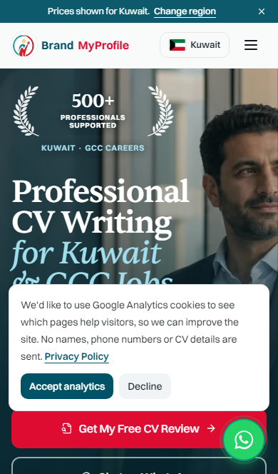

## FIRST SCREEN CHECK: brandmyprofile.com/kuwait
Nov 17, 2026 · the page the Google profile's website button should open, on a 390px phone

**What the customer was promised before tapping:** the Google profile shows *4.9★ from 32 reviews* and *Open 24 hours*, and your newest review says *"Very quick and fast response"*. No ads are running that I know of.

**Fix first: the cookie banner covers the headline and the main button.** On a phone, the banner ("We'd like to use Google Analytics cookies…") sits from about 60% to 87% of the screen. It cuts off "for Kuwait & GCC Jobs", hides the subheadline, and pushes "Get My Free CV Review" to the very bottom edge, where the WhatsApp bubble sits on top of it. The first thing a visitor does is close something, before they've read what you do. The fix is to make the banner a slim bar pinned to the bottom of the screen (one line: "We use analytics cookies. Accept · Decline · Privacy"), under 60px tall, and to move the WhatsApp bubble above it so they don't overlap. It's a component change, about 30 minutes.

**Then, in this order:**

| # | What a customer sees | Why it costs leads | Fix | Effort |
|---|---|---|---|---|
| 2 | The trust strip says only **"Google reviews · Read them"**, with no stars and no number | 4.9★ from 32 is strong proof, and it's what the visitor just saw on Maps. Hiding it makes them go back to check. | Show the live numbers the page already fetches: **"4.9★ · 32 Google reviews"**, falling back to "Read our Google reviews" if the fetch fails. Put it directly under the headline. | 20 min |
| 3 | **"From 4 KWD"** appears only in the strip below the first screen | It's your sharpest difference from the alternatives (Labeeb's Kuwait CV writing starts from KWD 25), and price-shoppers decide in the first screen | Add it to the subheadline: "Human-written, ATS-friendly CVs for Kuwait and GCC employers, **from 4 KWD**. Start with a free CV review." | 10 min |
| 4 | No reply time anywhere, while the profile says "Open 24 hours" | Your reviews praise fast replies; saying it turns a WhatsApp tap into a sure thing | Under the WhatsApp button: "Replies on WhatsApp within 15 minutes, [9am–10pm] Kuwait time". Add it only once the hours from the speed-to-lead plan are confirmed and kept. | 10 min |
| 5 | The **"500+ professionals supported"** badge is the first thing on the screen | It's the biggest claim on the page. Your own product rules say no unverified numbers, and a visitor who doubts it doubts the rest. | Keep it only if it's a real count (from your leads Sheet or orders). Otherwise replace it with the Google rating from item 2. | 5 min |
| 6 | The only tap-to-call link (+965 41103254) is in the footer, 17 screens down | Minor for a WhatsApp-first business, but the Google profile's Call button sends callers who expect a number. | Put the number as a tap-to-call link in the menu, next to WhatsApp. | 10 min |

**What already works:**
- The headline names the service and the place ("Professional CV Writing for Kuwait & GCC Jobs").
- There are two ways to act without calling: the free CV review form and WhatsApp with a pre-filled message.
- The page loads in about 1 second, and the main images weigh 36–50 KB.
- The structured data's phone matches the profile, and no self-made review rating is marked up.
- The pricing answer reads the live prices (4 / 7 / 10 KWD).

**A fault below the first screen:** the page sends its text inside `<noscript>`, so tools that read HTML without running JavaScript see none of it. A raw-HTML check of this page found 0 visible words. That's the fix-first item in the site audit, and it matters for Google and AI answers, not for phone visitors.

**Sources and assumptions:**
- Based on a 390×664 phone screenshot and a full-page capture taken Nov 17, 2026 (Chromium, 3–4 s wait), plus a scripted read of the rendered page for links, overlays, prices and image weights.
- The large blank areas in the full-page capture are almost certainly scroll-reveal animations that don't fire in a capture that never scrolls, so they're not counted as faults. Confirm by scrolling the page on your phone.
- Not checked: the free CV review form beyond its first step, and the page the profile button opens today (the homepage redirects to a country picker; the Google profile audit recommends pointing it at /kuwait).
- Confirm: whether "500+" is a real count, your WhatsApp response hours, and that the cookie banner change still meets your consent needs.
